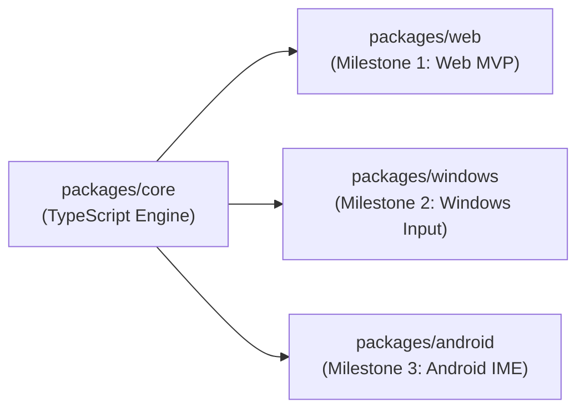

# PinyinDuck: Architecture & Implementation Plan

A TypeDuck-inspired Mandarin Pinyin input method designed specifically for Chinese language learners. It provides real-time candidate suggestions alongside concise English definitions, tone marks, and frequency ranking so novice speakers never have to guess whether they are selecting the right character or homophone.

---

## 1. Project Overview & Multi-Platform Roadmap



- **Milestone 1 (Complete)**: 
  - Monorepo setup with decoupled `@pinyinduck/core` and `@pinyinduck/web`.
  - Offline CC-CEDICT dictionary engine enriched with word frequency ranking, emitted as a **paged B+ tree** and read on demand rather than parsed into memory.
  - Interactive Web IME composition playground featuring inline candidate cards with character, tone marks, and short English glosses.
  - Two gated test layers: 242 Vitest unit tests over `packages/core` and 72 Playwright end-to-end tests over the browser IME, with coverage floors enforced as build gates in both.
  - oxlint as a single flat, non-type-aware static pass across the whole monorepo.
- **Milestone 2 (Complete)**:
  - Windows desktop integration via a Rime/Weasel (小狼毫) schema generated from the same
    `@pinyinduck/core` engine, so it is a real system input method rather than a
    keyboard hook. See `docs/roadmap.md` §2 and `packages/windows/README.md`.
  - The B+ tree asset is walked in key order and each homophone cluster is emitted as it
    is left, so the generator's peak memory is one cluster rather than the 122k-entry
    corpus. It emits a simplified and a traditional dictionary (~9.3MB each) whose
    candidate order matches the web app.
  - Two ranking defects the real corpus exposed were fixed in `scoreEntry`, both pinned
    by unit tests: UTF-16 length miscounted the 205 single characters outside the BMP as
    multi-character words, and one typed tone number awarded the tone bonus to any longer
    word whose first syllable matched.
- **Milestone 3 (Future)**:
  - Android keyboard input method via Android `InputMethodService` or Trime engine integration.

---

## 2. Monorepo Structure & Location

The project resides in:
`/home/raytray/repositories/pinyin-typeduck-windows` (Windows UNC: `\\wsl.localhost\Ubuntu\home\raytray\repositories\pinyin-typeduck-windows`)

Milestone 2 development happens on the `pinyin-typeduck-windows` branch. The
working tree is a WSL checkout of a Windows machine, so the platform work is
edited and built from WSL while the IME itself runs on the Windows host.

```text
pinyin-typeduck-windows/
├── .git/                          # Git repository initialized at root
├── .oxlintrc.json                 # Single flat oxlint config for the whole monorepo
├── PLAN.md                        # Master Architecture & Implementation Plan
├── package.json                   # Monorepo root (npm / pnpm workspaces)
├── tsconfig.base.json             # Shared TypeScript configuration
├── playwright.config.ts           # End-to-end test configuration (Playwright)
├── e2e/                           # Playwright regression specs for the web IME
├── packages/
│   ├── core/                      # Shared dictionary and Pinyin lookup engine
│   │   ├── package.json
│   │   ├── tsconfig.json
│   │   ├── vitest.config.ts       # Unit test config + enforced coverage floors
│   │   ├── src/
│   │   │   ├── parser/            # Pinyin tokenizer & syllable segmenter
│   │   │   ├── dictionary/        # CC-CEDICT gloss extraction
│   │   │   ├── data/              # B+ tree codec, builder, reader, page sources
│   │   │   ├── index/             # Trie & lazy search engines + candidate ranking
│   │   │   └── types.ts           # Shared data types
│   │   └── scripts/               # CC-CEDICT download & pre-indexing scripts
│   ├── web/                       # Web application (Milestone 1)
│   │   ├── package.json
│   │   ├── vite.config.ts
│   │   ├── index.html
│   │   ├── public/dictionary.btree    # Generated paged B+ tree, committed
│   │   └── src/
│   │       ├── components/
│   │       │   ├── Editor.tsx     # Simulated IME composition input area
│   │       │   ├── CandidatePopup.tsx  # Inline candidate cards with definitions
│   │       │   └── Toolbar.tsx    # Simplified/Traditional toggle & status
│   │       ├── hooks/
│   │       │   └── usePinyinDuck.ts    # React hook managing composition buffer
│   │       └── styles/            # Clean, modern styling
│   ├── windows/                   # Windows input method (Milestone 2)
│   │   ├── src/rime-dict.ts       # Rime dictionary emitter (pure, no fs)
│   │   ├── scripts/
│   │   │   ├── build-rime-dict.ts # Walks the B+ tree, writes both dictionaries
│   │   │   └── install.ps1        # Copies the schemas into %APPDATA%\Rime
│   │   └── rime/                  # Schemas (committed) + generated dictionaries
│   └── android/                   # (Milestone 3 — not created yet)
└── docs/
    └── roadmap.md                 # Architecture notes for Windows & Android
```

---

## 3. Core Engine (`packages/core`)

### 3.1 Dictionary Dataset & Frequency Weighting
- **CC-CEDICT**: Provides full coverage of Traditional and Simplified characters, Pinyin with tone numbers, and English translations.
- **Full corpus, lazily paged**: The whole of CC-CEDICT (125,132 lines) is compiled into a single generated asset rather than shipping a hand-written seed list. 122,746 unique `(word, reading)` pairs survive deduplication, covering 26,811 words with frequency data, 5,247 on the HSK list and 11,851 single characters. The asset is 9.12MB raw / 4.27MB gzipped, which is far too large to bundle and too large to hold in a low-memory process, so it is emitted to `packages/web/public/dictionary.btree` as a paged B+ tree keyed on toneless pinyin and fetched page by page at runtime. `npm run build:dict` regenerates it from three sources, caching downloads in `packages/core/.cache/`; `npm run build` runs it automatically.
  - Sources: [CC-CEDICT](https://www.mdbg.net/chinese/export/cedict/cedict_1_0_ts_utf-8_mdbg.txt.gz) (headwords, pinyin, definitions), [OpenSubtitles frequency list](https://github.com/hermitdave/FrequencyWords) (popularity), [HSK 2012 list](https://github.com/gigacool/hanyu-shuiping-kaoshi) (difficulty).
  - **Why a B+ tree**: the Android milestone needs the full corpus inside a keyboard process. Materializing 122k entries costs an object graph an order of magnitude larger than the file, so a client opens the asset by reading only its 24-byte header and page directory, then fetches just the pages a query touches. Resident memory is a bounded LRU page cache (256KB default) plus the scan budget, not the dictionary size. This is what makes Milestone 3 viable without a second, reduced dictionary.
  - **Layout**: `header | page directory (offset+length per page) | pages`. Leaves are chained by `nextLeaf` so a prefix query is one root-to-leaf descent followed by a bounded forward scan; internal pages store each child's *high* key, not its low key, because one pinyin reading can span several leaves and a low-key separator would drop the earlier (higher-scoring) entries. `packages/core/src/data/btree-builder.test.ts` pins that case.
  - **Page sources**: `PageSource` abstracts storage, so the same reader serves the browser (HTTP `Range`, degrading to a single whole-file read if a server ignores `Range`), tests, and an Android `mmap` via `MemoryPageSource`.
  - **Two engines, one ranker**: `LazyPinyinSearchEngine` reads pages per query; `PinyinSearchEngine` keeps the in-memory trie for tests and for callers that already hold the data. Both score through `scoreEntry` in `src/index/ranking.ts` and share one scan budget (`DEFAULT_MAX_MATCHES`, sized above the widest prefix in the corpus so the default path never truncates), so they return identical candidates and totals. The lazy engine breaks score ties deterministically, since trie insertion order is not reproducible from a page scan.
  - **Legacy format**: `--format json` still emits the whole dictionary as compact tuples (`[simplified, traditional, pinyinNumbers, gloss, frequency, hskLevel]`) for callers that want a single parse. Tone marks, clean pinyin and syllables are derived on read in both formats so they always match the pinyin column.
- **Frequency Indexing**: To prevent rare homophones from cluttering beginner suggestions (e.g. typing `ta` should prioritize `他`, `她`, `它` rather than archaic characters like `塌` or `挞`), dictionary entries are scored against a standard frequency corpus (e.g. SUBTLEX-CH / HSK frequency tables). Raw counts span four orders of magnitude, so they are log-scaled against the busiest word in the corpus onto the 0&ndash;100000 range the ranker expects; a linear map would flatten every mid-frequency word to indistinguishable noise.
- **Match quality outranks popularity**: The ranker spaces its match tiers 50000 apart and caps the largest popularity contribution at 30000, so an extremely common character can never displace a better match. Without this, real corpus frequencies break the intended behaviour &mdash; typing `nihao` surfaced `你` (3.2M occurrences) above `你好` (50k). The multi-character word boost is likewise capped rather than scaled by length, so `中国` stays ahead of `中国中央电视台`. Both rules are pinned by `packages/core/src/index/ranking.test.ts`.
- **Concise Gloss Extraction**: Long CC-CEDICT definition strings (`"also/in addition/more/still/else/yet"`) are cleaned and trimmed into crisp, readable glosses for instant visual scanning.

### 3.2 Pinyin Parsing & Syllable Segmentation
- **Toneless by default**: Typing `nihao` segments into syllables `ni` + `hao` and matches `你好`.
- **Tone Numbers (Engine-Level)**: When a query carries tone numbers (`ni3hao3` or `ni3 hao3`), the engine filters candidates strictly by tone, eliminating homophone confusion. Tone numbers are also automatically converted into standard tone marks (e.g., `ni3 hao3` &rarr; `nǐ hǎo`).
  > [!IMPORTANT]
  > **Key binding rule: number keys select candidates, they do not enter tone numbers.** Throughout an active composition the IME binds digit keys to candidate selection and never appends them to the pinyin buffer, so `shi4` picks candidate #4 rather than filtering to the fourth tone. This is the intended interaction, and it keeps candidate selection on a single predictable key. Tone-number queries therefore remain an `@pinyinduck/core` capability for direct callers and the planned native clients, where the digit key is not competing for the same role; the behavior is covered by the `packages/core` unit tests, and the key binding is pinned by `e2e/number-keys.spec.ts`.
- **Paging & Ranking**: Returns top candidates sorted by:
  1. Match quality tier: exact pinyin &rarr; pinyin prefix &rarr; query extends the entry
  2. Words before single characters within the same tier (capped bonus)
  3. Frequency / everyday usage score, then HSK level, as tiebreakers only
- **Result cap**: The Web hook requests at most 50 candidates, so a broad syllable like `ta` (199 readings) reports 10 pages rather than an unbounded list.

---

## 4. Web Application UX (`packages/web`)

### 4.1 Inline Candidate Cards
As the user types into the composition field:
1. **Composition Underline**: Displays the active raw pinyin buffer (e.g., `<u>nihao</u>`).
2. **Floating / Inline Candidate List**:
   ```
   +-------------------------------------------------------------+
   | [1] 你好    nǐ hǎo    hello / how are you?                 |
   | [2] 你      nǐ        you (singular)                       |
   | [3] 拟好    nǐ hǎo    to draft / draw up (a document)      |
   | [4] 泥耗    ní hào    mud consumption                      |
   +-------------------------------------------------------------+
   Page 1/3 (Press 1-4, Space to select, PageUp/PageDown or Up/Down to flip)
   ```
3. **Keyboard Controls**:
   - `1` &ndash; `9`: Instant selection of candidate number. **Number keys select candidates; they do not type tone numbers.** Digit keys stay bound to candidate selection for the entire duration of a composition and are never appended to the pinyin buffer, so `shi4` selects candidate #4 rather than entering a fourth tone. Out-of-range digits and `0` are ignored, and digits return to plain text input once no composition is active. This keeps candidate selection on one predictable key. See &sect;3.2 for the engine-side tone-number capability.
   - `Space`: Commit candidate #1.
   - `Enter`: Commit raw pinyin as English text.
   - `Backspace`: Delete previous pinyin letter or committed character.
   - `PageUp` / `PageDown` or `[` / `]`: Flip candidate pages.
   - `Escape`: Cancel composition.
4. **Script Switcher**: Toggle between **Simplified** (default) and **Traditional** Chinese characters at any time.

---

## 5. Execution Steps & Git Commit Checkpoints

> [!IMPORTANT]
> A Git repository is initialized at `/home/raytray/repositories/pinyin-typeduck-windows`, and a distinct Git commit will be created after completing each step.

1. **Step 1: Workspace & Monorepo Initialization** (Done)
   - Initialize Git repository and `.gitignore`.
   - Configure root workspace `package.json` and TypeScript configs.
   - Commit plan to repository.
   - **Git Commit**: `chore: initialize monorepo workspace and git repository` (`131eab4`)

2. **Step 2: Build `@pinyinduck/core`** (Done)
   - Implement CC-CEDICT parser script and generate a compact, fast client index with frequency ranking.
   - Implement Trie-based prefix search and syllable segmenter.
   - Add unit tests for pinyin parsing (toneless, tone numbers, apostrophes, multi-syllable segmentation).
   - **Git Commit**: `feat(core): implement dictionary indexing, pinyin parser, and candidate search` (`c8ccf65`)

3. **Step 3: Build `@pinyinduck/web`** (Done)
   - Set up Vite + React + TypeScript web app.
   - Implement the IME composition state engine (`usePinyinDuck`).
   - Build the candidate card dropdown with clean styling and keyboard shortcuts.
   - Connect the offline core dictionary engine.
   - **Git Commit**: `feat(web): implement IME composition playground and candidate cards UI` (`afe6f97`)

4. **Step 4: Verification, Polish & Multi-Platform Documentation** (Done)
   - Test typing common beginner phrases, homophone differentiation (`ta1`, `shi4`), and script toggling.
   - Document extension points and roadmap for Windows (Milestone 2) and Android (Milestone 3).
   - **Git Commit**: `docs: add multi-platform roadmap and test verification report` (`f47d0a1`)

5. **Step 5: Automated Regression Testing** (Done)
   - Add Playwright to the monorepo root, configured to boot the Vite dev server automatically, with a Chromium project and CI-aware retry/reporting settings.
   - Add an `e2e/` suite covering the full composition loop: candidate ranking, tone-mark and gloss rendering, paging across multiple pages, selection by digit / arrow / mouse, partial-match chaining, no-match fallback, raw-pinyin commit, script toggle, and clipboard / clear actions.
   - Ground every assertion in real search output rather than assumed values, so the suite stays meaningful as the dictionary grows. Every candidate expectation in the suite was re-derived after switching to the full CC-CEDICT asset, since the old 30-entry seed produced different (and in one case wrong) rankings, and again after moving the web app onto the lazy B-tree engine, which orders equal-scoring candidates deterministically instead of by trie insertion order.
   - Switching the web app to lazy loading made searching asynchronous, which turned out to be the hard part of the change: a commit key can arrive before the candidate list for the buffer it is committing exists. `usePinyinDuck` resolves this with a synchronous fast path from the displayed list, a commit queue for the reads that are still in flight, and refs for the buffer, caret and committed text so a commit cannot splice at a position the DOM has already moved past. `e2e/editing.spec.ts` documents which assertions can still read the editor without retrying.
   - `e2e/dictionary-loading.spec.ts` covers the lazy-load contract: the loading state, a blocked commit while a load is in flight, and 404 / 500 / malformed-payload failures surfacing a recovery hint rather than a false "no match" popup.
   - The suite surfaced that digits are reserved as candidate-pick shortcuts for the duration of a composition, which makes tone numbers unreachable from the Web IME. This is now the intended, explicitly documented behavior (see &sect;3.2 and &sect;4.1) and is pinned by `e2e/number-keys.spec.ts`; tone filtering remains covered by the `packages/core` unit tests.
   - Wire `npm run test:e2e`, `test:e2e:ui`, `test:e2e:headed` and `test:all` into the root workspace, and document the two test layers in the README.
   - **Git Commit**: `add playwright` (`ae40dcc`)

6. **Step 6: Full CC-CEDICT Dictionary** (Done)
   - Replace the 30-entry hand-written seed with the complete CC-CEDICT corpus, generated into a compact tuple asset and lazy loaded at runtime.
   - Make the build script reproducible: cache the three downloads, validate every pinyin column before emitting, and report parsed / emitted / coverage counts.
   - Fix the two ranking defects the real corpus exposed, where popularity could override match quality.
   - **Git Commit**: `fill the dictionary` (`21acf76`)

7. **Step 7: Coverage Gates & Suite Hardening** (Done)
   - Add per-glob coverage floors to `packages/core/vitest.config.ts` so a regression in the engine or the dictionary pipeline fails the run rather than only being reported, and exclude re-export barrels and type-only modules that would report misleading zeroes.
   - Extend the dictionary builder's own test coverage to the download, cache and file-writing paths (`build-dictionary-io.test.ts`, against a stubbed `fetch` and an in-memory `fs`), holding the build script to the same bar as the runtime engine.
   - Add a Playwright V8-profiler fixture and `e2e/web-coverage-reporter.ts` so the web package's coverage is measured from the browser run and enforced with a non-zero exit code.
   - **Git Commit**: `add tests for better coverage` (`e9caa1e`), `code clean up` (`fbdd30a`), `fix timing out tests` (`b822a9a`)

8. **Step 8: Paged B+ Tree Dictionary** (Done — 2026-09-29)
   - Replace the single-blob dictionary asset with a paged B+ tree (`src/data/btree-codec.ts`, `btree-builder.ts`, `btree-dictionary.ts`, `page-source.ts`) keyed on toneless pinyin, so a client reads a 24-byte header and a page directory rather than materializing 122k entries. See §3.1.
   - Add `LazyPinyinSearchEngine` alongside the trie engine, with both ranking through the shared `scoreEntry` and sharing one scan budget, so they return identical candidates and totals. Extract `scoreEntry` into `src/index/ranking.ts` and have the trie engine delegate to it.
   - Break score ties deterministically in the lazy engine, since trie insertion order is not reproducible from a page scan.
   - Add `e2e/insert-position.spec.ts`, covering where a committed candidate lands relative to a live caret: click and digit picks at the caret, repeated picks not drifting, two commits landing in order, and a commit landing behind a caret the user moved on purpose.
   - **Git Commit**: `feat: lazy-load the dictionary from a paged B+ tree` (`3391280`)

9. **Step 9: Linting** (Done — 2026-09-29)
   - Add ESLint across the monorepo, and use the pass to clean up: drop a redundant `setState` on mount in `Editor.tsx`, rename `cursorToRestore` to `cursorToRestoreRef` to say that it is a ref, and move a redundant trailing `-` out of a character class in the pinyin parser.
   - **Superseded the same day** by Step 10.
   - **Git Commit**: `add eslint` (`cb5df50`)

10. **Step 10: oxlint** (Done — 2026-09-29)
    - Replace ESLint with oxlint behind a single flat `.oxlintrc.json` covering `packages/core`, `packages/web`, `e2e/` and the tool configs, dropping ~1,300 lines of dependencies and running the whole pass in ~90ms.
    - Enable oxlint's `correctness` category with the `typescript` and `react` plugins. Scope `react/*` to `packages/web/src` (run repo-wide it flags Playwright's fixture callback, which is also named `use`), and turn `react/set-state-in-effect` off for `usePinyinDuck.ts` only, where the dictionary load's status reset is load-bearing.
    - oxlint is deliberately not type-aware, so linting stays a static pass with no program; `tsc` runs separately in `strict` mode and the two do not overlap.
    - **Git Commit**: `swap to oxlint` (`11c245b`)

11. **Step 11: Windows Input Method** (Done — 2026-09-29)
    - Build Windows as a Rime/Weasel schema rather than the Tauri overlay of Approach A. The working tree is a WSL checkout and neither side has a Rust toolchain, so a Tauri app could not be compiled or verified here at all; Rime is a real registered TSF input method that the OS already knows how to activate, focus and compose, so the work is the part that is PinyinDuck's — the dictionary and its ranking. See `docs/roadmap.md` §2 for the trade-off and `packages/windows/README.md` for install and verification.
    - Add `packages/windows`: `src/rime-dict.ts` emits Rime's `.dict.yaml` format (a YAML header plus a TSV body) from the same B+ tree, and `scripts/build-rime-dict.ts` walks the asset in key order, emitting each homophone cluster as the scan leaves it, so the corpus is never held in memory. Both dictionaries build in ~1s.
    - Pin the format against librime rather than against the tutorial version of it: the body is TSV (since 1.9), `columns` must declare `comment` (the built-in default is text/code/weight with **no comment column**, so an undeclared gloss is dropped silently), and `Vocabulary::SortHomophones` is a *stable* sort by weight, which makes the emitted order the tiebreak — so the generator mirrors `scoreEntry` and `compareScored` exactly. Measured over the real asset, 103,521 readings and 121,304 rows agree with the web engine; the 3 that do not are CC-CEDICT's own `ㄏㄤ` / `PO` / `TA` syllable-abbreviation rows, where the Rime file ranks the real character first.
    - Two schemas over two generated dictionaries, switched with `F4` / ``Ctrl+` ``: the traditional one uses CC-CEDICT's own traditional column instead of converting with OpenCC at runtime. `default.custom.yaml` appends both to the scheme switcher, so a Weasel update cannot overwrite them.
    - `scripts/install.ps1` verifies all five files exist before copying anything, clears `%APPDATA%\Rime\build` so a stale compiled table cannot be reused, and prints the deploy step.
    - Fix the two ranking defects the parity work exposed in `scoreEntry`: `String.length` counts UTF-16 units, so the 205 CC-CEDICT characters outside the BMP were each treated as a two-character word and given the word boost (typing `an1` offered 𩽾 above 安); and one typed tone number awarded the full tone bonus to any longer word whose *first* syllable matched (typing `bian3` offered 彼岸 above 扁). A tone filter now only constrains as many syllables as the query has tones.
    - **Git Commit**: `feat(windows): add the PinyinDuck Rime input method`

---

## 6. Current Verification State

Re-measured on the `pinyin-typeduck-windows` branch after Step 11:

| Check | Command | Result |
| --- | --- | --- |
| Core unit tests | `npm test -w @pinyinduck/core` | 13 files, 248 tests passed |
| Core coverage | `npm run test:coverage -w @pinyinduck/core` | 99% statements, 97.29% branches, 99% functions; gate passes (exit 0) |
| Windows unit tests | `npm test -w @pinyinduck/windows` | 2 files, 47 tests passed |
| Windows coverage | `npm run test:coverage -w @pinyinduck/windows` | 97.94% statements, 96.66% branches, 100% functions; gate passes (exit 0) |
| Rime dictionary build | `npm run build:rime` | 122,746 rows simplified, 122,734 traditional (12 duplicate collapses), 0 unusable, ~1s |
| End-to-end tests | `npm run test:e2e` | 72 tests passed |
| Web coverage | `npm run test:e2e` | 98.93% statements, 99.24% branches, 100% functions |
| Lint | `npm run lint` | 0 warnings, 0 errors over 52 files |

> [!NOTE]
> `npm run typecheck` resolves to nothing: the root script uses `--if-present` and no
> workspace defines a `typecheck` script. Type errors are caught by `npm run build` —
> `tsc` in `packages/core`, `tsc && vite build` in `packages/web`, and `tsc --noEmit`
> over `src` **and** `scripts` in `packages/windows`, which is why that package is the
> one that needs `@types/node`.

> [!NOTE]
> The coverage floors are 95% statements / 88% branches for `packages/core/src/**`,
> 95% across the board for `packages/core/scripts/**`, and 95% on all four metrics for
> `packages/windows`, each on an 80% global floor. No package reports 100% on every
> metric: the B+ tree work added defensive branches (malformed input, whole-file
> fallback, engine-parity tie ordering) that are only partially covered, and the Windows
> generator leaves its `import.meta.url` command line entry uncovered.

> [!NOTE]
> The Rime dictionaries cannot be executed in this repository, so the last mile is
> manual: `packages/windows/README.md` carries a verification table whose expected
> candidate lists were read out of the generated asset rather than assumed. The client's
> *ordering* was checked against the web engine over the whole corpus (see Step 11), but
> deploying to Windows is still unverified here, since the host has no Rime installed.

