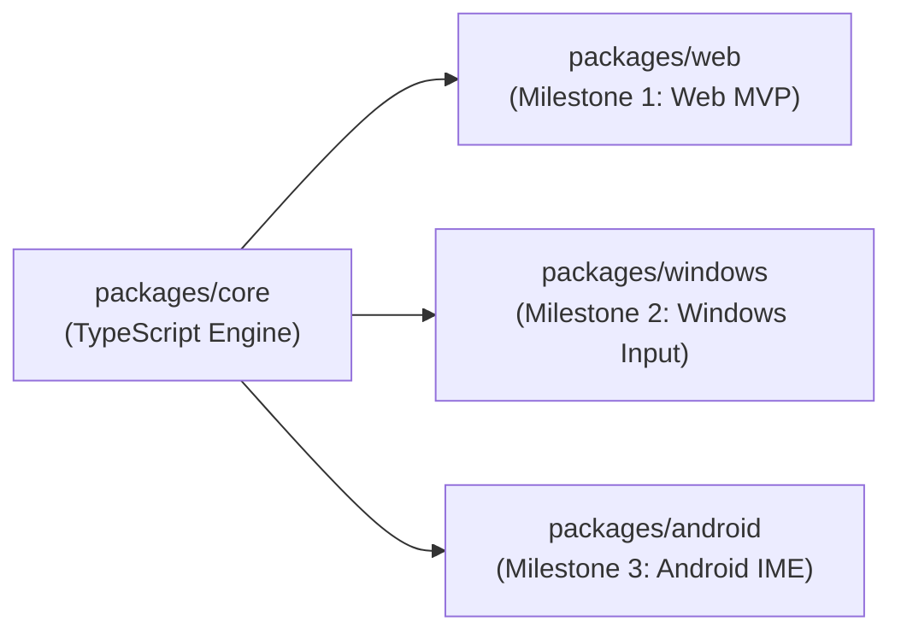

# PinyinDuck: Architecture & Implementation Plan

A TypeDuck-inspired Mandarin Pinyin input method designed specifically for Chinese language learners. It provides real-time candidate suggestions alongside concise English definitions, tone marks, and frequency ranking so novice speakers never have to guess whether they are selecting the right character or homophone.

---

## 1. Project Overview & Multi-Platform Roadmap



- **Milestone 1 (Current Scope - MVP)**: 
  - Monorepo setup with decoupled `@pinyinduck/core` and `@pinyinduck/web`.
  - Offline Trie-based CC-CEDICT dictionary engine enriched with word frequency ranking.
  - Interactive Web IME composition playground featuring inline candidate cards with character, tone marks, and short English glosses.
- **Milestone 2 (Next)**:
  - Windows desktop integration (exploring a background system assistant / Tauri global overlay or Windows Text Services Framework / Rime schema).
- **Milestone 3 (Future)**:
  - Android keyboard input method via Android `InputMethodService` or Trime engine integration.

---

## 2. Monorepo Structure & Location

The project resides in:
`/home/raytray/repositories/pinyin-typeduck` (Windows UNC: `\\wsl.localhost\Ubuntu\home\raytray\repositories\pinyin-typeduck`)

```text
pinyin-typeduck/
├── .git/                          # Git repository initialized at root
├── PLAN.md                        # Master Architecture & Implementation Plan
├── package.json                   # Monorepo root (npm / pnpm workspaces)
├── tsconfig.base.json             # Shared TypeScript configuration
├── packages/
│   ├── core/                      # Shared dictionary and Pinyin lookup engine
│   │   ├── package.json
│   │   ├── tsconfig.json
│   │   ├── src/
│   │   │   ├── parser/            # Pinyin tokenizer & syllable segmenter
│   │   │   ├── dictionary/        # CC-CEDICT loader, compact binary/JSON index
│   │   │   ├── index/             # Prefix search Trie & candidate ranking
│   │   │   └── types.ts           # Shared data types
│   │   └── scripts/               # CC-CEDICT download & pre-indexing scripts
│   └── web/                       # Web application (Milestone 1)
│       ├── package.json
│       ├── vite.config.ts
│       ├── index.html
│       └── src/
│           ├── components/
│           │   ├── Editor.tsx     # Simulated IME composition input area
│           │   ├── CandidatePopup.tsx  # Inline candidate cards with definitions
│           │   └── Toolbar.tsx    # Simplified/Traditional toggle & status
│           ├── hooks/
│           │   └── usePinyinDuck.ts    # React hook managing composition buffer
│           └── styles/            # Clean, modern styling
└── docs/
    └── roadmap.md                 # Architecture notes for Windows & Android
```

---

## 3. Core Engine (`packages/core`)

### 3.1 Dictionary Dataset & Frequency Weighting
- **CC-CEDICT**: Provides full coverage of Traditional and Simplified characters, Pinyin with tone numbers, and English translations.
- **Frequency Indexing**: To prevent rare homophones from cluttering beginner suggestions (e.g. typing `ta` should prioritize `他`, `她`, `它` rather than archaic characters like `塌` or `挞`), dictionary entries are scored against a standard frequency corpus (e.g. SUBTLEX-CH / HSK frequency tables).
- **Concise Gloss Extraction**: Long CC-CEDICT definition strings (`"also/in addition/more/still/else/yet"`) are cleaned and trimmed into crisp, readable glosses for instant visual scanning.

### 3.2 Pinyin Parsing & Syllable Segmentation
- **Toneless by default**: Typing `nihao` segments into syllables `ni` + `hao` and matches `你好`.
- **Optional Tone Numbers**: Typing `ni3hao3` or `ni3 hao3` filters candidates strictly to third tone syllables, eliminating homophone confusion.
- **Tone Mark Conversion**: Automatically converts tone numbers into standard tone marks (e.g., `ni3 hao3` &rarr; `nǐ hǎo`).
- **Paging & Ranking**: Returns top candidates sorted by:
  1. Exact pinyin match length
  2. Frequency / everyday usage score
  3. Character count (words before single characters for multi-syllable inputs)

---

## 4. Web Application UX (`packages/web`)

### 4.1 Inline Candidate Cards
As the user types into the composition field:
1. **Composition Underline**: Displays the active raw pinyin buffer (e.g., `<u>nihao</u>`).
2. **Floating / Inline Candidate List**:
   ```
   +-------------------------------------------------------------+
   | [1] 你好    nǐ hǎo    hello / how are you?                 |
   | [2] 你      nǐ        you (singular)                       |
   | [3] 拟好    nǐ hǎo    to draft / draw up (a document)      |
   | [4] 泥耗    ní hào    mud consumption                      |
   +-------------------------------------------------------------+
   Page 1/3 (Press 1-4, Space to select, PageUp/PageDown or Up/Down to flip)
   ```
3. **Keyboard Controls**:
   - `1` &ndash; `9`: Instant selection of candidate number.
   - `Space`: Commit candidate #1.
   - `Enter`: Commit raw pinyin as English text.
   - `Backspace`: Delete previous pinyin letter or committed character.
   - `PageUp` / `PageDown` or `[` / `]`: Flip candidate pages.
   - `Escape`: Cancel composition.
4. **Script Switcher**: Toggle between **Simplified** (default) and **Traditional** Chinese characters at any time.

---

## 5. Execution Steps & Git Commit Checkpoints

> [!IMPORTANT]
> A Git repository is initialized at `/home/raytray/repositories/pinyin-typeduck`, and a distinct Git commit will be created after completing each step.

1. **Step 1: Workspace & Monorepo Initialization** (Done)
   - Initialize Git repository and `.gitignore`.
   - Configure root workspace `package.json` and TypeScript configs.
   - Commit plan to repository.
   - **Git Commit**: `chore: initialize monorepo workspace and git repository` (`131eab4`)

2. **Step 2: Build `@pinyinduck/core`** (Done)
   - Implement CC-CEDICT parser script and generate a compact, fast client index with frequency ranking.
   - Implement Trie-based prefix search and syllable segmenter.
   - Add unit tests for pinyin parsing (toneless, tone numbers, apostrophes, multi-syllable segmentation).
   - **Git Commit**: `feat(core): implement dictionary indexing, pinyin parser, and candidate search` (`c8ccf65`)

3. **Step 3: Build `@pinyinduck/web`** (Done)
   - Set up Vite + React + TypeScript web app.
   - Implement the IME composition state engine (`usePinyinDuck`).
   - Build the candidate card dropdown with clean styling and keyboard shortcuts.
   - Connect the offline core dictionary engine.
   - **Git Commit**: `feat(web): implement IME composition playground and candidate cards UI` (`afe6f97`)

4. **Step 4: Verification, Polish & Multi-Platform Documentation** (Done)
   - Test typing common beginner phrases, homophone differentiation (`ta1`, `shi4`), and script toggling.
   - Document extension points and roadmap for Windows (Milestone 2) and Android (Milestone 3).
   - **Git Commit**: `docs: add multi-platform roadmap and test verification report`

