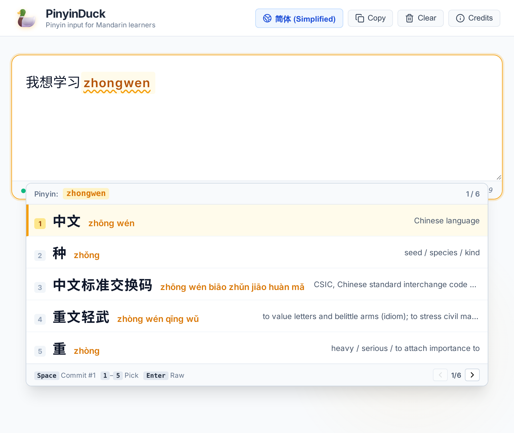

# PinyinDuck

PinyinDuck is a Mandarin input method for language learners. As you type pinyin, it shows
tone-marked candidates with concise English definitions, ranked by match quality, word
length, frequency, and HSK level.

PinyinDuck is inspired by [TypeDuck](https://typeduck.hk), a Cantonese input method.
It is an independent project, not an official TypeDuck spin-off, and it is not affiliated
with or endorsed by the TypeDuck team.

**[Try it in your browser](https://raytray.github.io/pinyin-duck/)**: no install needed.



## Status

| Platform | Status | How to get it |
| --- | --- | --- |
| Web | Working | [Live demo](https://raytray.github.io/pinyin-duck/), or `npm run dev` |
| Android | Beta | Build from source: [`packages/android`](packages/android/README.md) |
| Windows | Beta, needs [Weasel](https://rime.im) | Build from source: [`packages/windows`](packages/windows/README.md) |
| macOS | Beta, needs [Squirrel](https://rime.im) | Build from source: [`packages/macos`](packages/macos/README.md) |

Beta means usable day to day, but with no prebuilt releases yet and rough edges you may
hit. [Bug reports](CONTRIBUTING.md#reporting-bugs) are welcome.

## Packages

| Package | Description |
| --- | --- |
| `packages/core` | Dictionary engine, pinyin parser, search, ranking, and asset generation. |
| `packages/web` | Browser-based IME playground. |
| `packages/android` | Android keyboard app. |
| `packages/rime` | Shared Rime schema templates, dictionary emitter and librime checks for Windows and macOS. |
| `packages/windows` | Windows IME via Rime/Weasel: the installer. |
| `packages/macos` | macOS IME via Rime/Squirrel: the installer. |

## Architecture

- `packages/core` builds a paged B+ tree dictionary from CC-CEDICT, frequency data, and
  HSK levels. A reader decodes only the pages a query touches, through an LRU page cache.
- The web app downloads the whole dictionary once, gzipped and at a content-hashed URL,
  showing progress while it loads. Search and commits are then synchronous.
- `packages/core` ships TypeScript source, not build output: its `package.json` `exports`
  point at `src/index.ts`. Web and Rime both depend on it as `@pinyinduck/core` and import
  only that package name, so `tsc`, Vite, Vitest and `tsx` all read core's source directly
  and nothing has to build core first.
- Search is a B-tree engine (synchronous over the asset in memory on the web, with a
  Kotlin port on Android that reads an mmapped file) that ranks through the shared
  `scoreEntry` formula and `compareScored` order.
- Pinyin is segmented into Mandarin syllables; tone numbers can filter readings at the
  engine level.
- Candidates are deduplicated by displayed Hanzi and ranked by exact/prefix match,
  multi-character word preference, frequency, and HSK level.

## Key behavior

- Number keys select candidates during composition; they do not enter tone numbers.
  Tone-number filtering remains available to direct callers of `@pinyinduck/core`.
- Web reports at most 50 candidates per query.
- Script can be toggled between Simplified and Traditional Chinese.

## Prerequisites

- Node.js with npm workspaces.
- Java 17 for the Android package.
- Rime tooling for Windows/macOS verification (see package READMEs).

## Quick start

```bash
npm install
npm run build:dict
npm run dev
```

The generated dictionary asset is not committed. Build it once per checkout.

## Common commands

```bash
npm run build          # build the dictionary and package assets
npm run lint           # repository lint checks
npm test               # unit tests
npm run test:e2e       # browser integration tests
npm run test:all       # unit + e2e tests
npm run test:coverage:all
npm run ci -w @pinyinduck/<core|web|android|rime>   # one package's CI checks
```

Each package's `ci` script runs exactly what that package's CI job runs. Build the
dictionary assets first (`npm run build:dict && npm run build:rime`). Android needs Java 17
and the Android SDK; Rime runs its librime check only after `npm run setup:rime`.

## Platform packages

- Web: `npm run dev`
- Android: `cd packages/android && ./gradlew assembleDebug`
- Windows: `npm run build:rime`, then follow `packages/windows/README.md`
- macOS: `npm run build:rime`, then follow `packages/macos/README.md`

## Testing

```bash
npm test
npm run test:e2e
```

Use `npx playwright install chromium` once if the browser binary is missing.

Locally, the e2e suite reuses a dev server already running on its port (5173 by default),
so `npm run dev` keeps reruns fast. If that server belongs to another checkout or
worktree, the run stops before any test with a message saying so. Stop that server, or
give this checkout its own port with `E2E_PORT=5174 npm run test:e2e`.

Android:

```bash
cd packages/android && ./gradlew test
cd packages/android && ./gradlew check
```

## Deployment

`.github/workflows/deploy-pages.yml` publishes `packages/web` to GitHub Pages after CI
passes on a push to `main`, building the exact commit CI checked. It can also be run by
hand from `main`. It builds with `BASE_PATH=/<repo>/` so asset URLs resolve under the
project-site path. The repository's **Settings → Pages → Source** must be set to
**GitHub Actions**.

To check the base-path build locally:

```bash
BASE_PATH=/pinyin-duck/ npm run build -w @pinyinduck/web
BASE_PATH=/pinyin-duck/ npm run preview -w @pinyinduck/web
```

## Contributing

See [CONTRIBUTING.md](CONTRIBUTING.md). Report security issues privately as described in
[SECURITY.md](SECURITY.md).

## Package docs

- [`packages/android/README.md`](packages/android/README.md)
- [`packages/rime/README.md`](packages/rime/README.md)
- [`packages/windows/README.md`](packages/windows/README.md)
- [`packages/macos/README.md`](packages/macos/README.md)

## License

The code is under the [MIT License](LICENSE). The dictionary is built from CC-CEDICT,
FrequencyWords and an HSK word list, and the built dictionary files are under
CC BY-SA 4.0. [DATA_LICENSES.md](DATA_LICENSES.md) credits each source and lists the
files that license covers.
