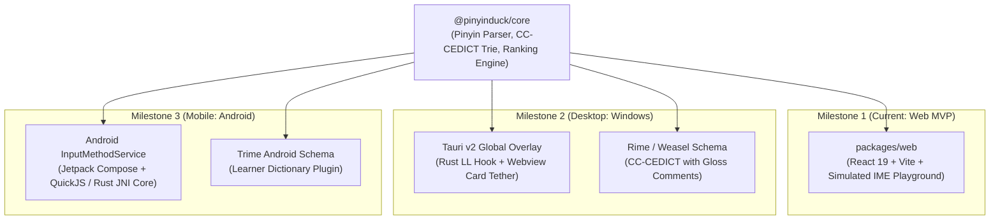

# PinyinDuck Multi-Platform Roadmap & Verification Report

## 1. Multi-Platform Architecture Overview

PinyinDuck is architected around a decoupled, headless core engine (`@pinyinduck/core`) that provides dictionary indexing, pinyin syllable segmentation, tone conversion, and candidate ranking. This shared layer powers the web playground and future native input methods across desktop and mobile.

---

## 2. Milestone 2: Windows Input Architecture

To give Mandarin learners real-time English definitions anywhere in Windows (Notepad, Word, Discord, browsers), two architectures are detailed below:

### Approach A: Tauri Global Assistant (Recommended for Fast Iteration)
1. **Background Tray App**:
   - Built with Tauri v2 (Rust backend + React frontend).
   - Runs in the Windows system tray with low memory footprint (~25 MB).
2. **Global Keystroke Interception**:
   - Registers a low-level keyboard hook using Windows API `SetWindowsHookExW(WH_KEYBOARD_LL, ...)`.
   - When composition starts (letters `a-z` typed), prevents default key dispatch to the foreground window.
3. **Caret Tracking & Floating Overlay**:
   - Uses `GetGUIThreadInfo` to locate the active window's cursor caret coordinates (`rcCaret`).
   - Positions a borderless, always-on-top Webview window (`CandidatePopup`) directly below the typing caret.
4. **Text Injection**:
   - When a candidate is committed (Space or numbers `1`–`9`), sends Unicode characters via `SendInput` using `KEYEVENTF_UNICODE` / `VK_PACKET`.

### Approach B: Rime / Weasel Engine Schema (Native TSF IME)
1. **Windows Text Services Framework (TSF)**:
   - Rather than authoring a COM C++ TSF driver from scratch, utilize the battle-tested **Rime (Weasel / 小狼毫)** framework.
2. **Schema & Dictionary Generation**:
   - Generate a custom Rime dictionary (`pinyinduck.dict.yaml`) where the comment field of each entry is populated with the concise CC-CEDICT English definition.
   - Configure candidate layout in `weasel.custom.yaml` to display candidate comments horizontally with distinctive tone coloring.

---

## 3. Milestone 3: Android Input Architecture

### Native Keyboard via `InputMethodService`
1. **Android IME Lifecycle**:
   - Inherits `android.inputmethodservice.InputMethodService`.
   - Inflates an onscreen keyboard layout using Jetpack Compose.
   - Overrides `onKey`, `onText`, and interacts with `InputConnection.commitText()` and `setComposingText()`.
2. **Core Engine Bridge**:
   - **Option 1 (Embedded JS Engine)**: Pack `@pinyinduck/core` into a single lightweight JS bundle and execute via Hermes or QuickJS Android NDK wrapper.
   - **Option 2 (Rust JNI Port)**: Port Trie lookup to a small Rust crate and generate Kotlin bindings via `uniffi-rs` for zero-overhead, sub-millisecond lookups.
3. **Dictionary: mmap the B+ tree, do not parse it**:
   - Ship `dictionary.btree` in the APK's assets and `mmap` it. `MemoryPageSource` reads byte ranges straight off the mapping, so a lookup costs a few page touches and no allocation, and the kernel can page the file out under memory pressure instead of the process holding it.
   - This is why the asset is paged rather than a JSON blob: the full corpus is 9.12MB on disk but the resident cost is the 256KB page cache plus the few pages a query touches. Loading the whole dictionary into a JS or Kotlin object graph would cost far more than the file and is what a keyboard process cannot afford.
   - On a cold cache the first query per prefix pays a page read; the web app already range-fetches the same way, so the paging and cache behaviour is testable before any Android code exists.
3. **Candidate Strip UI**:
   - Primary candidate strip displays top 3 suggestions with compact Hanzi + tone mark.
   - Tapping an expand button displays a floating dialog with full candidate cards and English definitions.

---

## 4. Test Verification Report

### Unit Tests (`packages/core`)

#### Test Execution Metrics
- **Test Runner**: Vitest v3.2.7
- **Test Suites**: 13 passed
- **Tests**: 242 passed, 0 failed
- **Command**: `npm test`

| Suite | Tests | Covers |
| :--- | :--- | :--- |
| `src/parser/pinyin.test.ts` | 21 | Tone marks, umlaut handling, apostrophe splitting, normalization |
| `src/dictionary/gloss.test.ts` | 14 | CC-CEDICT definition trimming |
| `src/index/search.test.ts` | 6 | Engine search behaviour against a small fixture dictionary |
| `src/index/ranking.test.ts` | 6 | Popularity is a tiebreaker, never an override of match quality |
| `src/index/search-options.test.ts` | 19 | Search option defaults, tone edge cases, trie traversal |
| `src/index/lazy-search.test.ts` | 24 | Lazy engine ranking, paging, tone filters, scan budget, engine parity |
| `src/data/btree-codec.test.ts` | 29 | Varints, page/header/directory encode + decode, malformed input |
| `src/data/btree-builder.test.ts` | 13 | Entry ordering, multi-level trees, keys spanning several leaves |
| `src/data/btree-dictionary.test.ts` | 20 | Descent, leaf-chain walking, page-cache bounds, error propagation |
| `src/data/page-source.test.ts` | 9 | Range requests, whole-file fallback, HTTP error reporting |
| `src/data/load-dictionary.test.ts` | 15 | Legacy wire-format decoding and loader error handling |
| `scripts/build-dictionary.test.ts` | 38 | CC-CEDICT / frequency / HSK parsing and frequency normalization |
| `scripts/build-dictionary-io.test.ts` | 27 | Download caching, both output formats, CLI flag handling |

#### Verified Test Cases

| Category | Query | Expected Candidate #1 | Tested Behavior | Status |
| :--- | :--- | :--- | :--- | :--- |
| **Common Greetings** | `nihao` | **你好** (nǐ hǎo - hello / how are you) | Exact multi-syllable word match | ✅ PASS |
| **Common Phrases** | `zhongguo` | **中国** (zhōng guó - China) | Multi-syllable compound matching | ✅ PASS |
| **Homophone Ranking** | `ta` | **他** (tā - he / him) | Common pronoun prioritized over rare homophone **塌** (tā - to collapse) | ✅ PASS |
| **Tone Filtering (Tone 4)** | `ta4` | **踏** (tà - to step on) | Filtered strictly to tone 4, excluding tone 1 **他** | ✅ PASS |
| **Homophone Disambiguation** | `shi4` | **是** (shì - to be / is / are) | Prioritizes 4th tone over 2nd tone **十** (shí - ten) | ✅ PASS |
| **Apostrophe Splitting** | `xi'an` | **西安** (xī ān) | Segments into `xi` + `an`, distinguishing from `xian` | ✅ PASS |
| **Tone Mark Normalization** | `ni3 hao3` | `nǐ hǎo` | Placement rules on vowels (a/e > ou > last vowel) | ✅ PASS |
| **Umlaut Handling** | `lü4` / `lv4` | `lǜ` | Umlaut conversion and diacritic placement | ✅ PASS |
| **Script Toggle** | `zhongguo` | **中國** (traditional) | Correctly outputs Traditional characters when script toggled | ✅ PASS |
| **Prefix Matching** | `niha` | **你好** | Partial syllable prefix candidate retrieval | ✅ PASS |

> [!NOTE]
> The tone-number cases above exercise the **engine API directly**. They are not reachable
> from the Web IME keyboard, where digits are reserved as candidate-pick shortcuts for the
> duration of a composition (see `PLAN.md` &sect;3.2).

### End-to-End Tests (`e2e/`)

#### Test Execution Metrics
- **Test Runner**: Playwright v1.63.0 (Chromium)
- **Tests**: 66 passed, 0 failed
- **Suites**: `composition`, `candidate-paging`, `number-keys`, `toolbar`, `editing`, `dictionary-loading`
- **Command**: `npm run test:e2e` (boots the Vite dev server automatically)

> [!NOTE]
> The web app reads the dictionary lazily, so a commit key can arrive before the pages
> for the buffer it is committing have been read. Commits therefore land a tick after the
> keypress; the two punctuation tests in `editing.spec.ts` assert the editor with a
> retrying `toHaveValue` rather than a single read, and the helper in that file documents
> which assertions may still read synchronously.

> [!IMPORTANT]
> Every candidate expectation is pinned to the full CC-CEDICT corpus. `gotoApp` waits for
> the dictionary status to report a loaded entry count before asserting, so no test can
> pass against an empty index.

#### Covered Behaviors
- **Composition Lifecycle**: Buffer growth, uppercase normalization, `Backspace` per letter, `Escape` cancel, `Enter` raw-pinyin commit, cursor resumption after commit.
- **Candidate Ranking**: Order, tone marks and English glosses rendered per card; assertions pinned to real engine output.
- **Paging**: A broad syllable cluster (`ta` &rarr; 199 readings, capped to 50 candidates over 10 pages) via pager buttons, `PageUp` / `PageDown` and `[` / `]`, including the disabled state on the last page and paging reset on buffer change.
- **Selection**: Digit pick, arrow-key navigation including page roll-over, and mouse hover.
- **Partial Matches**: Committing a prefix candidate keeps the leftover syllable buffered.
- **No-Match Handling**: Empty-state messaging plus raw-text fallback on `Enter`.
- **Script Toggle**: Simplified/Traditional candidate rendering, buffer preservation across toggle, and committed-text stability.
- **Toolbar**: Copy to clipboard, clear, and disabled-state gating.
- **Number Keys**: Digit reservation during composition, including out-of-range and `0` handling.
- **Dictionary Loading**: The status indicator, a commit key swallowed while a load is in flight, the buffer surviving the transition to ready, and 404 / 500 / malformed-payload failures surfacing a `build:dict` recovery hint while raw pinyin stays committable.

---

## 5. Build Verification

- **`npm run build:dict`**: Full CC-CEDICT generation passed in ~2.2s from cache. 125,132 lines parsed, 122,746 rows emitted (2,386 duplicate readings dropped), 26,811 with frequency, 5,247 on the HSK list, 11,851 single characters. Emitted a 9.12MB (4.27MB gzipped) B+ tree of 1,196 pages, which reads back as the same 122,746 entries.
- **`@pinyinduck/core`**: `tsc` build passed with zero errors (`dist/index.d.ts`, `dist/index.js`).
- **`@pinyinduck/web`**: `tsc && vite build` passed with zero errors. The JS bundle contains no dictionary data; `dist/dictionary.btree` is copied as a separate static asset, confirming the dictionary is genuinely lazy rather than bundled.
- **Cross-engine parity**: the lazy and in-memory engines were compared over 4,004 sampled queries drawn from the real corpus. Every query returned the same `total`, and the 930 queries whose top-20 ordering differed were permutations of the *same* candidate set where the swapped entries score identically — the B-tree scan cannot reproduce trie insertion order, so ties are broken deterministically instead. Zero queries showed a real ranking difference.
