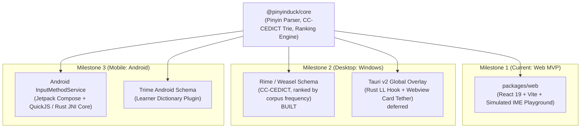

# PinyinDuck Multi-Platform Roadmap & Verification Report

## 1. Multi-Platform Architecture Overview

PinyinDuck is architected around a decoupled, headless core engine (`@pinyinduck/core`) that provides dictionary indexing, pinyin syllable segmentation, tone conversion, and candidate ranking. This shared layer powers the web playground and future native input methods across desktop and mobile.

---

## 2. Milestone 2: Windows Input Architecture

To give Mandarin learners feedback anywhere in Windows (Notepad, Word, Discord, browsers), two architectures were designed. **Approach B was built**, and it was then checked against a real Rime engine rather than against the format documentation — which changed two of its premises.

### Approach B: Rime / Weasel Engine Schema — Implemented

1. **Windows Text Services Framework (TSF)**:
   - Rather than authoring a COM C++ TSF driver from scratch, utilize the battle-tested **Rime (Weasel / 小狼毫)** framework.
2. **Schema & Dictionary Generation**:
   - `packages/windows/scripts/build-rime-dict.ts` walks the shared B+ tree and emits `pinyinduck.dict.yaml` (122,687 rows), `pinyinduck_trad.dict.yaml` (122,734 rows) and `lua/pinyinduck_gloss.lua` (197,268 definitions), where the comment column of each entry carries its tone marks and concise CC-CEDICT English definition.
   - `pinyinduck.schema.yaml` sets `always_show_comments: true`, keeps the digits **out of** `speller/alphabet`, and references a `lua_filter` that puts the definition on each candidate — see below.
   - The traditional scheme uses CC-CEDICT's own traditional column rather than converting with OpenCC at runtime, so 中国 is offered as 中國 because that is what the source says.
3. **Why this won.** The Windows client is a real, registered IME, so the OS already handles activation, focus, composing strings and per-app compatibility. That leaves the work being the part that is PinyinDuck's: the dictionary and the ranking, both of which come from `@pinyinduck/core` unchanged. It also builds and is tested from this WSL checkout — Approach A cannot be compiled or verified here at all, because neither the WSL side nor the Windows host has a Rust toolchain or MSVC.

### What running the real engine changed

`npm run setup:rime` builds librime 1.13.1 from source in gitignored `tools/`, without
sudo, and `npm run test:rime` types into it. The first run of that check contradicted two
things written above:

- **The digits are now out of `speller/alphabet`, and the codes are toneless.** The design
  assumed number keys would keep selecting candidates. They can: the speller only reaches a
  code whose every character is in the alphabet, so with toneless codes (`shi`, `ni hao`) and
  a digit-free alphabet, a number typed while composing falls through to the selector and
  picks the candidate under it. That is the behaviour the rest of PinyinDuck already has.
  `shi` gives every tone, merged and ordered by frequency, and `2` commits 十; `nihao`
  reaches 你好 because the code is `ni hao` and the space delimiter never has to appear
  mid-word.
- **The gloss is shown, by a Lua filter.** `RawDictEntry` is `text`/`code`/`weight` and
  `EntryCollector` never reads a comment column, at any version including master, so
  `always_show_comments` alone shows the candidate's own code — `shi`, identical for all
  five homophones. The filter closes that: it reads a generated sidecar and attaches the
  definition. Without librime-lua the schema still works and the comment falls back to the
  spelling echo.

The two full write-ups are `PLAN.md` §Step 11b and `packages/windows/README.md` §"What
Rime cannot show".

### Approach A: Tauri Global Assistant — Not Built

1. **Background Tray App**:
   - Built with Tauri v2 (Rust backend + React frontend).
   - Runs in the Windows system tray with low memory footprint (~25 MB).
2. **Global Keystroke Interception**:
   - Registers a low-level keyboard hook using Windows API `SetWindowsHookExW(WH_KEYBOARD_LL, ...)`.
   - When composition starts (letters `a-z` typed), prevents default key dispatch to the foreground window.
3. **Caret Tracking & Floating Overlay**:
   - Uses `GetGUIThreadInfo` to locate the active window's cursor caret coordinates (`rcCaret`).
   - Positions a borderless, always-on-top Webview window (`CandidatePopup`) directly below the typing caret.
4. **Text Injection**:
   - When a candidate is committed (Space or numbers `1`–`9`), sends Unicode characters via `SendInput` using `KEYEVENTF_UNICODE` / `VK_PACKET`.

Retained as a fallback for a future milestone if the Rime candidate window is ever judged too plain for a learner: it would carry the exact candidate-card UI of the web app. The costs that ruled it out for this milestone are the multi-GB Visual Studio Build Tools install it needs on the host, an extra resident process, having to re-implement composing and candidate windows, and its coexistence with the IME Windows already has installed. Nothing about the dictionary or the ranking would be reusable from Approach A — both approaches read the same `@pinyinduck/core` output, which is why the choice does not fork the project.

---

## 3. Milestone 3: Android Input Architecture — as built

Shipped as `packages/android`. The design below is what this section originally proposed; the
outcome and the one place it changed are recorded underneath it.

### As originally proposed

1. **Android IME Lifecycle**: Inherit `android.inputmethodservice.InputMethodService`, inflate
   an on-screen keyboard built with Jetpack Compose, and drive the editor through
   `InputConnection.commitText()` and `deleteSurroundingText()`.
2. **Core Engine Bridge**:
   - *Option 1 (Embedded JS engine)*: bundle `@pinyinduck/core` and run it on Hermes or QuickJS.
   - *Option 2 (Rust JNI port)*: port the lookup to a native crate for sub-millisecond results.
3. **Dictionary: mmap the B+ tree, do not parse it.** Ship `dictionary.btree` in the APK's
   assets and read byte ranges straight off the mapping, so resident cost is the page cache
   rather than the corpus.
4. **Candidate Strip UI**: a primary strip of suggestions with compact Hanzi and tone marks,
   plus an expand affordance showing full candidate cards with English definitions.

### As built

Everything in point 3 is unchanged: the APK stores `dictionary.btree` **uncompressed** so a
file descriptor can be opened, the service maps it on a background thread, and each lookup
descends the tree behind a 256KB LRU page cache. The committed asset is the same file the
web app serves, and the Android build copies it rather than duplicating it in the repo.

Points 1 and 4 are as proposed: an `InputMethodService` with a Compose keyboard, a paged
candidate strip, and an expanded list of candidate cards showing Hanzi, tone-marked pinyin,
HSK level and the English gloss. The strip pages rather than showing only the top three,
because a syllable like `ta` has 1,476 candidates and a three-slot strip would need a page
of arrows.

**Point 2 took Option 2's shape rather than Option 1's, in Kotlin rather than Rust.** The
deciding factor is that the engine is *synchronous* here: with the asset mmapped, a page read
is a pointer offset, so `onKeyDown` ranks candidates and commits in the same call. Routing
every keystroke through a JS engine would add a bridge hop and a promise microtask queue per
keypress, and the engine's async `search()` could then resolve out of order relative to the
keystrokes that produced it — the exact hazard the web client had to solve with a commit
queue and refs.

The Hermes option also turned out not to be available as originally hoped: the standalone
`com.facebook.hermes.Hermes` eval API is an artifact of older React Native releases, and the
current `hermes-android` AAR ships only `BuildConfig` and Intl classes. A standalone build
would have needed a third-party QuickJS or JSC binding.

The cost of a port is that the two engines can drift, so that is covered rather than
assumed: `packages/core/scripts/generate-android-parity.ts` runs the real TypeScript engine
over the real dictionary for 26 pinned queries and writes a golden file, and
`PinyinEngineParityTest` asserts the Kotlin engine reproduces it exactly — same ordering,
same tone marks, same glosses, same totals. `npm run build:parity` regenerates it whenever
the ranking rules or the dictionary change.

### Divergence worth recording

On the web, digits select candidates for the whole duration of a composition, which makes
tone-number input unreachable (see `PLAN.md` §3.2). On Android the candidates are picked
by tapping, so the number row is free to carry tone numbers instead: `shi` then `4` narrows
the strip to shì. This is the behaviour `README.md` had already anticipated when it said
tone filtering was for “the planned Windows and Android clients, where the digit key is not
competing for the same role.”

---

## 4. Test Verification Report

### Unit Tests (`packages/core`)

#### Test Execution Metrics
- **Test Runner**: Vitest v3.2.7
- **Test Suites**: 13 passed
- **Tests**: 248 passed, 0 failed
- **Command**: `npm test -w @pinyinduck/core`

| Suite | Tests | Covers |
| :--- | :--- | :--- |
| `src/parser/pinyin.test.ts` | 21 | Tone marks, umlaut handling, apostrophe splitting, normalization |
| `src/dictionary/gloss.test.ts` | 14 | CC-CEDICT definition trimming |
| `src/index/search.test.ts` | 6 | Engine search behaviour against a small fixture dictionary |
| `src/index/ranking.test.ts` | 11 | Popularity is a tiebreaker, never an override of match quality; supplementary-plane characters are not words; tone filters across word lengths |
| `src/index/search-options.test.ts` | 19 | Search option defaults, tone edge cases, trie traversal |
| `src/index/lazy-search.test.ts` | 24 | Lazy engine ranking, paging, tone filters, scan budget, engine parity |
| `src/data/btree-codec.test.ts` | 29 | Varints, page/header/directory encode + decode, malformed input |
| `src/data/btree-builder.test.ts` | 13 | Entry ordering, multi-level trees, keys spanning several leaves |
| `src/data/btree-dictionary.test.ts` | 20 | Descent, leaf-chain walking, page-cache bounds, error propagation |
| `src/data/page-source.test.ts` | 9 | Range requests, whole-file fallback, HTTP error reporting |
| `src/data/load-dictionary.test.ts` | 15 | Legacy wire-format decoding and loader error handling |
| `scripts/build-dictionary.test.ts` | 38 | CC-CEDICT / frequency / HSK parsing and frequency normalization |
| `scripts/build-dictionary-io.test.ts` | 27 | Download caching, both output formats, CLI flag handling |

### Unit Tests (`packages/windows`)

#### Test Execution Metrics
- **Test Runner**: Vitest v3.2.7
- **Test Suites**: 6 passed
- **Tests**: 212 passed, 0 failed (including a sweep of all 245,421 emitted rows)
- **Coverage**: 98.89% statements, 98.57% branches, 100% functions (gate: 95% on all four)
- **Command**: `npm test -w @pinyinduck/windows`

Separately, and not part of the unit run, `npm run test:rime` types into a real librime
1.13.1 built from source by `npm run setup:rime`: **8 of 8 queries as pinned, no known
gap**, no `Encode failure` in the log.

| Suite | Tests | Covers |
| :--- | :--- | :--- |
| `src/rime-dict.test.ts` | 56 | Column order, the weight formula against `scoreEntry`, tie order against `compareScored`, toneless codes, multi-variant readings split into one row each, unreadable readings rejected, tone marks and gloss formatting, duplicate collapsing, and a whole dictionary built and read back through a real B+ tree |
| `src/rime-format.test.ts` | 40 | An independent reader for the emitted format, written against librime's `GetColumnIndex` and `LoadDictEntry` rather than against our own writer |
| `src/rime-verify.test.ts` | 52 | The harness transcript parser, smoke-case evaluation (candidate order, commit, preedit, gloss), and the report format |
| `scripts/build-rime-dict-io.test.ts` | 19 | Flag handling, both output files and the sidecar, header and body shape, a missing asset, a corrupt asset, the `unencodable` statistic, and the CLI output |
| `scripts/generated-dicts.test.ts` | 11 | The whole corpus: no duplicate text/code pair, no whitespace in a candidate, no weight librime would demote, every menu in descending weight, a candidate for every typeable code, and a byte-for-byte rebuild against a second run of the writer |
| `scripts/verify-rime-io.test.ts` | 34 | Staging (including the `essay.txt` filter that keeps 880 warnings out of the log), the harness protocol, timeout detection, and the CLI's four exit paths against a stub harness |

The suite pins the Rime dictionary format against librime's source rather than against a
tutorial, because a drift still compiles and still deploys while silently reordering the
candidate list — and, as Step 11b established, a tutorial is not a substitute for running
the engine. See `packages/windows/README.md`.

#### Verified Test Cases

| Category | Query | Expected Candidate #1 | Tested Behavior | Status |
| :--- | :--- | :--- | :--- | :--- |
| **Common Greetings** | `nihao` | **你好** (nǐ hǎo - hello / how are you) | Exact multi-syllable word match | ✅ PASS |
| **Common Phrases** | `zhongguo` | **中国** (zhōng guó - China) | Multi-syllable compound matching | ✅ PASS |
| **Homophone Ranking** | `ta` | **他** (tā - he / him) | Common pronoun prioritized over rare homophone **塌** (tā - to collapse) | ✅ PASS |
| **Tone Filtering (Tone 4)** | `ta4` | **踏** (tà - to step on) | Filtered strictly to tone 4, excluding tone 1 **他** | ✅ PASS |
| **Homophone Disambiguation** | `shi4` | **是** (shì - to be / is / are) | Prioritizes 4th tone over 2nd tone **十** (shí - ten) | ✅ PASS |
| **Apostrophe Splitting** | `xi'an` | **西安** (xī ān) | Segments into `xi` + `an`, distinguishing from `xian` | ✅ PASS |
| **Tone Mark Normalization** | `ni3 hao3` | `nǐ hǎo` | Placement rules on vowels (a/e > ou > last vowel) | ✅ PASS |
| **Umlaut Handling** | `lü4` / `lv4` | `lǜ` | Umlaut conversion and diacritic placement | ✅ PASS |
| **Script Toggle** | `zhongguo` | **中國** (traditional) | Correctly outputs Traditional characters when script toggled | ✅ PASS |
| **Prefix Matching** | `niha` | **你好** | Partial syllable prefix candidate retrieval | ✅ PASS |

> [!NOTE]
> The tone-number cases above exercise the **engine API directly**. They are not reachable
> from the Web IME keyboard, where digits are reserved as candidate-pick shortcuts for the
> duration of a composition (see `PLAN.md` &sect;3.2). The Windows schema now does the same
> thing: its codes are toneless and its alphabet has no digits, so a number typed while
> composing selects the candidate under it. `shi` gives every tone, merged, and `2` commits
> 十.

> [!NOTE]
> Two of these expectations changed when Milestone 2 compared the Windows client against
> the engine over the whole corpus, and both fixes are in `scoreEntry`:
> `String.length` counted UTF-16 units, so the 205 CC-CEDICT characters outside the BMP were
> treated as multi-character words (typing `an1` offered 𩽾 above **安**), and one typed tone
> number awarded the full tone bonus to any longer word whose *first* syllable matched
> (typing `bian3` offered **彼岸** above 扁). A tone filter now only constrains as many
> syllables as the query has tones. Pinned by `packages/core/src/index/ranking.test.ts`.
>
> The `✅ PASS` marks in that table are the *web and core* results. The Windows client now
> also shows an English definition on every candidate, delivered by a Lua filter over a
> generated sidecar — see "What running the real engine changed" above.

### Cross-Client Parity (`packages/windows` → Rime)

The Windows menu and the web candidate list are ranked by the same rules, which is only
true if the emitted dictionary preserves them. Measured over the real asset by comparing
each Rime menu against the engine's results for the same reading:

| Check | Result |
| :--- | :--- |
| Readings compared | 103,521 (every code a user can type) |
| Rows compared | 121,304 |
| Orderings identical | 103,518 (99.997%) |
| Orderings that differ | 3 — CC-CEDICT's `ㄏㄤ`, `PO` and `TA` syllable abbreviations, where the Rime file ranks the real character first |

### End-to-End Tests (`e2e/`)

#### Test Execution Metrics
- **Test Runner**: Playwright v1.63.0 (Chromium)
- **Tests**: 72 passed, 0 failed
- **Suites**: `composition`, `candidate-paging`, `number-keys`, `toolbar`, `editing`, `dictionary-loading`, `insert-position`
- **Command**: `npm run test:e2e` (boots the Vite dev server automatically)

> [!NOTE]
> The web app reads the dictionary lazily, so a commit key can arrive before the pages
> for the buffer it is committing have been read. Commits therefore land a tick after the
> keypress; the two punctuation tests in `editing.spec.ts` assert the editor with a
> retrying `toHaveValue` rather than a single read, and the helper in that file documents
> which assertions may still read synchronously.

> [!IMPORTANT]
> Every candidate expectation is pinned to the full CC-CEDICT corpus. `gotoApp` waits for
> the dictionary status to report a loaded entry count before asserting, so no test can
> pass against an empty index.

#### Covered Behaviors
- **Composition Lifecycle**: Buffer growth, uppercase normalization, `Backspace` per letter, `Escape` cancel, `Enter` raw-pinyin commit, cursor resumption after commit.
- **Candidate Ranking**: Order, tone marks and English glosses rendered per card; assertions pinned to real engine output.
- **Paging**: A broad syllable cluster (`ta` &rarr; 199 readings, capped to 50 candidates over 10 pages) via pager buttons, `PageUp` / `PageDown` and `[` / `]`, including the disabled state on the last page and paging reset on buffer change.
- **Selection**: Digit pick, arrow-key navigation including page roll-over, and mouse hover.
- **Partial Matches**: Committing a prefix candidate keeps the leftover syllable buffered.
- **No-Match Handling**: Empty-state messaging plus raw-text fallback on `Enter`.
- **Script Toggle**: Simplified/Traditional candidate rendering, buffer preservation across toggle, and committed-text stability.
- **Toolbar**: Copy to clipboard, clear, and disabled-state gating.
- **Number Keys**: Digit reservation during composition, including out-of-range and `0` handling.
- **Dictionary Loading**: The status indicator, a commit key swallowed while a load is in flight, the buffer surviving the transition to ready, and 404 / 500 / malformed-payload failures surfacing a `build:dict` recovery hint while raw pinyin stays committable.

---

## 5. Build Verification

- **`npm run build:dict`**: Full CC-CEDICT generation passed in ~2.2s from cache. 125,132 lines parsed, 122,746 rows emitted (2,386 duplicate readings dropped), 26,811 with frequency, 5,247 on the HSK list, 11,851 single characters. Emitted a 9.12MB (4.27MB gzipped) B+ tree of 1,196 pages, which reads back as the same 122,746 entries.
- **`@pinyinduck/core`**: `tsc` build passed with zero errors (`dist/index.d.ts`, `dist/index.js`).
- **`@pinyinduck/web`**: `tsc && vite build` passed with zero errors. The JS bundle contains no dictionary data; `dist/dictionary.btree` is copied as a separate static asset, confirming the dictionary is genuinely lazy rather than bundled.
- **`@pinyinduck/windows`**: `tsc --noEmit` passed with zero errors over `src` and `scripts`.
- **`npm run build:rime`**: walked the 9.12MB B+ tree in ~1s and emitted `pinyinduck.dict.yaml` (122,746 rows) and `pinyinduck_trad.dict.yaml` (122,734 rows, 12 duplicates dropped, 0 unusable). Neither the asset nor the corpus is held in memory: the tree is scanned in key order and each homophone cluster is emitted as the scan leaves it.
- **Cross-engine parity**: the lazy and in-memory engines were compared over 4,004 sampled queries drawn from the real corpus. Every query returned the same `total`, and the 930 queries whose top-20 ordering differed were permutations of the *same* candidate set where the swapped entries score identically — the B-tree scan cannot reproduce trie insertion order, so ties are broken deterministically instead. Zero queries showed a real ranking difference.
- **Cross-client parity**: the generated Rime dictionaries were compared against the web engine over every typeable reading — see §4.
- **Not verified here**: deploying to Windows. The host has no Rime installed, so the schemas have never been loaded by librime. The format is pinned against librime's source and the expected candidate lists in `packages/windows/README.md` are read out of the generated asset, but the last mile is a manual step.
